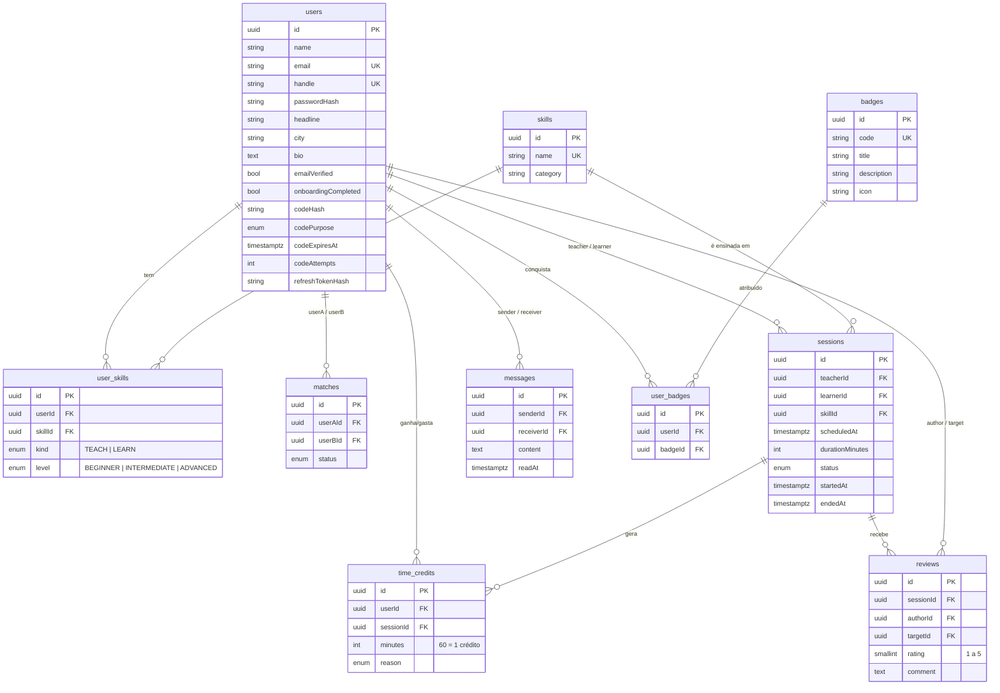

# Modelo de dados (ERD)

Todas as entidades abaixo existem no código desde a Fase 0 (as tabelas são criadas ao arrancar com `DB_SYNCHRONIZE=true`).
Os módulos (controllers/serviços) de cada uma entram na fase indicada.

## Decisões

- **Créditos como livro-razão** (`time_credits`): o saldo é a soma de `minutes`, em vez de um contador no utilizador. É auditável e evita saldos inconsistentes. 1 hora ensinada = +60 para quem ensina e -60 para quem aprende.
- **Competências com tipo** (`user_skills.kind`): uma só tabela guarda o que o utilizador ensina e o que quer aprender. Níveis válidos: ensinar = INTERMEDIATE/ADVANCED; aprender = BEGINNER/INTERMEDIATE.
- **Códigos de e-mail** (verificação e recuperação) ficam no próprio utilizador, só como hash, com validade de 15 min e máximo de 5 tentativas.
- **Refresh token**: guarda-se o hash do último emitido (uma sessão ativa por utilizador no MVP). Se quiseres várias sessões em simultâneo (telemóvel + tablet), passa para uma tabela `refresh_tokens`.

## Notas das Fases 2 e 3

- **`matches`:** `userAId` é quem pede, `userBId` quem recebe. Estados: `SUGGESTED` (pedido pendente), `ACCEPTED` (ligados), `DECLINED`.
- **`time_credits`:** índice único `(sessionId, userId, reason)` torna a liquidação de sessões idempotente. Índice único parcial garante um só bónus de boas-vindas (`SIGNUP_BONUS`) por utilizador.
